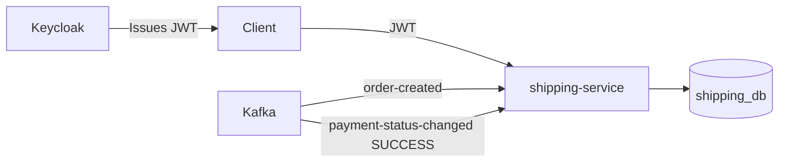
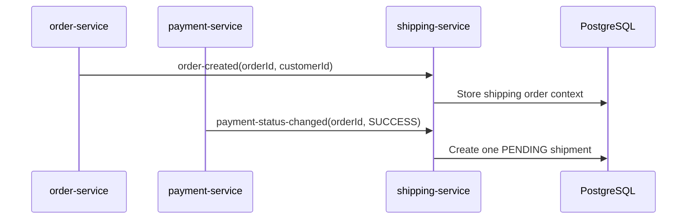

# SpareLink Shipping Service

[](https://github.com/tadiwanashe-mashongwa/shipping-service/actions/workflows/ci.yml)

Shipping microservice for **SpareLink**. It stores order/customer context from Kafka, creates one shipment after a successful payment, and tracks dispatch and delivery.

## Architecture



## Shipment creation flow



## API

| Endpoint | Access |
|---|---|
| `GET /api/shipments/me` | Authenticated customer; own shipments |
| `GET /actuator/health` | Public |
| `/v3/api-docs`, `/swagger-ui/**` | Public |

Swagger: `http://localhost:8086/swagger-ui/index.html`

## State model

```text
PENDING -> DISPATCHED (carrier + tracking number) -> DELIVERED
```

## Testing

```powershell
mvn test
```

The TDD suite covers shipment state changes, idempotent paid-order creation, JWT protection, Kafka listener delegation, and real PostgreSQL/Flyway persistence through Testcontainers. JaCoCo reports are generated in `target/site/jacoco/`.

## Structure

```text
shipment/  shipment domain, Kafka listeners, API and persistence
config/    security and OpenAPI configuration
```
