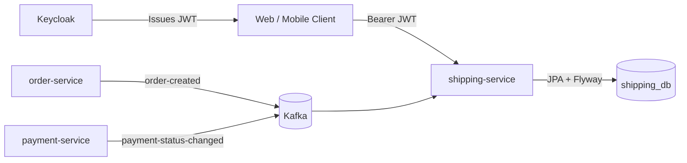
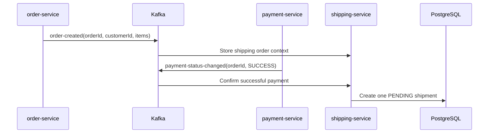
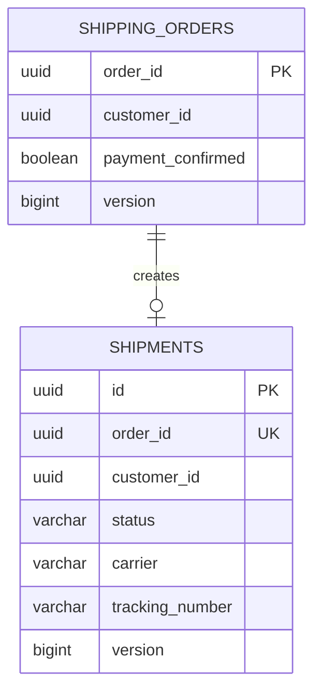

# SpareLink Shipping Service

[](https://github.com/tadiwanashe-mashongwa/shipping-service/actions/workflows/ci.yml)
[](https://github.com/tadiwanashe-mashongwa/shipping-service/actions/workflows/ci.yml)
[](https://openjdk.org/projects/jdk/21/)
[](https://spring.io/projects/spring-boot)

Shipping microservice for **SpareLink**, an automotive spare-parts platform. It consumes order and payment lifecycle events, creates one shipment per paid order, and lets administrators dispatch and deliver shipments securely.

## Highlights

- Java 21, Spring Boot 3.5.5, PostgreSQL, Flyway, JPA/Hibernate
- Kafka-driven order context and successful-payment processing
- Idempotent shipment creation: one order produces at most one shipment
- Shipment lifecycle rules: `PENDING → DISPATCHED → DELIVERED`
- Keycloak JWT resource-server security with `CUSTOMER` and `ADMIN` roles
- OpenAPI/Swagger, Actuator, Docker, GitHub Actions and JaCoCo
- Testcontainers PostgreSQL persistence tests with real Flyway migrations

## Architecture



## Shipment creation flow



## Database model



## API

| Endpoint | Access | Purpose |
|---|---|---|
| `GET /api/shipments/me` | `CUSTOMER`, `ADMIN` | List the authenticated customer's shipments |
| `POST /api/shipments/{orderId}/dispatch` | `ADMIN` | Assign carrier/tracking number and dispatch a pending shipment |
| `POST /api/shipments/{orderId}/deliver` | `ADMIN` | Mark a dispatched shipment as delivered |
| `GET /actuator/health` | Public | Liveness/health check |

Dispatch request:

```json
{
  "carrier": "DHL",
  "trackingNumber": "TRACK-123"
}
```

Swagger UI: `http://localhost:8086/swagger-ui/index.html`

## Security and ownership

`GET /api/shipments/me` takes its customer identity from `JWT.sub`; clients cannot provide a customer ID. Keycloak realm roles are mapped to Spring `ROLE_CUSTOMER` and `ROLE_ADMIN`. Administrative lifecycle actions are denied to customers.

## Running locally

```powershell
mvn test
mvn spring-boot:run
```

The default local database is `shipping_db` on PostgreSQL port `5432`. In the platform stack, use Docker Compose from the parent `SpareLink` directory; the service is exposed on port `8086`.

## Testing strategy

The TDD suite covers domain transition rules, idempotent paid-order shipment creation, Kafka JSON listener contracts, customer ownership, admin authorization, controller mapping, and PostgreSQL/JPA/Flyway persistence through Testcontainers.

Run the full suite with `mvn test`. JaCoCo HTML reports are generated at `target/site/jacoco/index.html`; GitHub Actions publishes the coverage badge on pushes to `main`.

## Project structure

```text
shipment/  domain, services, Kafka listeners, REST API and persistence
config/    Keycloak security and OpenAPI configuration
db/        Flyway migrations
```
