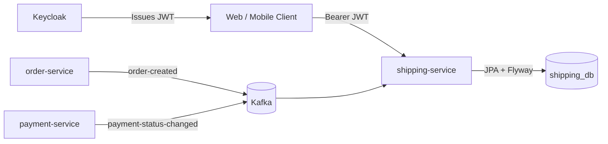
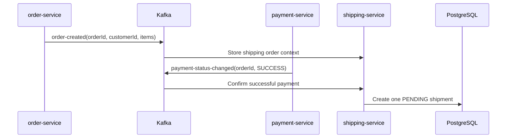
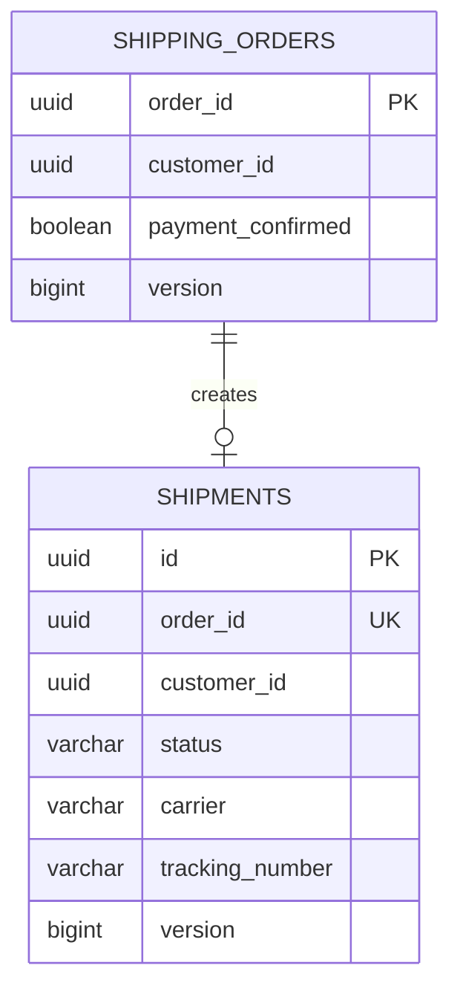
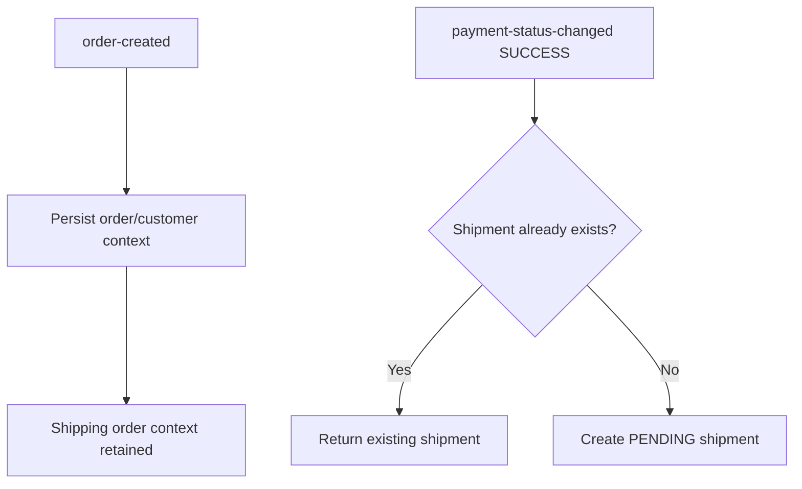

# SpareLink Shipping Service

[](https://github.com/tadiwanashe-mashongwa/shipping-service/actions/workflows/ci.yml)
[](https://github.com/tadiwanashe-mashongwa/shipping-service/actions/workflows/ci.yml)
[](https://openjdk.org/projects/jdk/21/)
[](https://spring.io/projects/spring-boot)

Shipping microservice for **SpareLink**, an automotive spare-parts platform. It consumes order and payment lifecycle events, creates one shipment per paid order, and lets administrators dispatch and deliver shipments securely.

## Highlights

- Java 21, Spring Boot 3.5.5, PostgreSQL, Flyway, JPA/Hibernate
- Kafka-driven order context and successful-payment processing
- Idempotent shipment creation: one order produces at most one shipment
- Shipment lifecycle rules: `PENDING → DISPATCHED → DELIVERED`
- Keycloak JWT resource-server security with `CUSTOMER` and `ADMIN` roles
- OpenAPI/Swagger, Actuator, Docker, GitHub Actions and JaCoCo
- Testcontainers PostgreSQL persistence tests with real Flyway migrations

## Architecture



## Shipment creation flow



## Database model



## Local run

Run the complete SpareLink stack from the parent platform repository:

```powershell
docker compose up --build -d
```

| Resource | URL |
|---|---|
| Shipping API | `http://localhost:8086` |
| Health | `http://localhost:8086/actuator/health` |
| OpenAPI JSON | `http://localhost:8086/v3/api-docs` |
| Swagger UI | `http://localhost:8086/swagger-ui/index.html` |
| Keycloak | `http://localhost:8080` |

For service-only development, configure PostgreSQL database `shipping_db`, Kafka and `KEYCLOAK_ISSUER_URI`, then run:

```powershell
mvn spring-boot:run
```

## API and access control

| Endpoint | Access | Purpose |
|---|---|---|
| `GET /api/shipments/me` | `CUSTOMER`, `ADMIN` | List the authenticated customer's shipments |
| `POST /api/shipments/{orderId}/dispatch` | `ADMIN` | Assign carrier/tracking number and dispatch a pending shipment |
| `POST /api/shipments/{orderId}/deliver` | `ADMIN` | Mark a dispatched shipment as delivered |
| `GET /actuator/health` | Public | Liveness/health check |

Health and OpenAPI endpoints are public. Keycloak bearer tokens are required for API calls.

Dispatch request body:

```json
{
  "carrier": "DHL",
  "trackingNumber": "TRACK-123"
}
```

## Security and ownership

`GET /api/shipments/me` takes its customer identity from `JWT.sub`; clients cannot provide a customer ID. Keycloak realm roles are mapped to Spring `ROLE_CUSTOMER` and `ROLE_ADMIN`. Administrative lifecycle actions are denied to customers.

## Events

| Direction | Topic | Event | Behaviour |
|---|---|---|---|
| Consumed | `order-created` | Order-created JSON | Records the order/customer shipping context; unknown event fields are intentionally ignored for forward compatibility. |
| Consumed | `payment-status-changed` | Payment-status-changed JSON | Creates a shipment only when status is `SUCCESS`. |

## Reliability and idempotency



The service treats duplicate successful-payment events safely: `order_id` is unique in `shipments`, and the application checks for an existing shipment before it inserts one. This is necessary because Kafka delivery is at-least-once.

## Testing strategy

The test suite follows TDD and uses the smallest realistic layer for each behaviour:

| Layer | Scope |
|---|---|
| Unit | Shipment transitions, idempotency, dispatch/delivery service rules, Kafka listener contracts |
| MVC slice | Controller mapping and JWT customer/admin authorization |
| JPA slice | Real PostgreSQL repository persistence and Flyway migrations |
| Platform smoke test | Real local Kafka `order-created → payment-status-changed SUCCESS → PENDING shipment` flow |

Run everything locally:

```powershell
mvn test
```

The JaCoCo HTML report is generated at `target/site/jacoco/index.html`.

## Project structure

```text
src/main/java/com/example/shippingservice
├── shipment      domain, services, Kafka listeners, REST API and persistence
├── config        Keycloak security and OpenAPI configuration
└── ...

src/main/resources
└── db/migration  Flyway migrations
```
